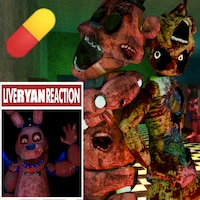

[UPDATE SOON] Zajcu37 Archiv Pill Pack

## Original credits and source

> **Disclaimer:** This pill was not created by me or the Sherlock HnS team. The original work belongs to its respective creators, who retain all credits for it.

- **Original name:** [UPDATE SOON] Zajcu37 Archiv Pill Pack
- **Original author:** kaleb
- **Official release:** [Steam Workshop](https://steamcommunity.com/sharedfiles/filedetails/?id=3637838829)

## Sherlock HnS adaptation

This version has been adapted from the original pill to improve compatibility and integration with the **Sherlock HnS** server. Changes were made to work with the server's systems and API. These adaptations do not imply authorship of the original work, which remains the property of its creator.

## Support and community

If you encounter any issues with this version, contact **tomate007_** or **sherlockvitinho** in our **Discord community**.

- **Sherlock HnS Discord:** [Join our community](https://discord.gg/EHXbAmpbse)

---

## Créditos e origem

> **Aviso:** esta pill não foi criada por mim nem pela equipe Sherlock HnS. O conteúdo original pertence aos seus respectivos autores, que mantêm todos os créditos pela criação.

- **Nome original:** [UPDATE SOON] Zajcu37 Archiv Pill Pack
- **Autor original:** kaleb
- **Publicação oficial:** [Steam Workshop](https://steamcommunity.com/sharedfiles/filedetails/?id=3637838829)

## Adaptação para o Sherlock HnS

Esta versão foi adaptada a partir da pill original para melhorar a compatibilidade e a integração com o servidor **Sherlock HnS**. Foram feitas alterações para funcionar com os sistemas e a API do servidor. Essas adaptações não representam autoria sobre o trabalho original, que continua pertencendo ao seu criador.

## Suporte e comunidade

Se encontrar algum problema com esta versão, entre em contato com **tomate007_** ou **sherlockvitinho** dentro da nossa **comunidade no Discord**.

- **Discord do Sherlock HnS:** [Entre na nossa comunidade](https://discord.gg/EHXbAmpbse)
---

Origem desta cópia: SteamCMD. Extração com fastgmad. Conteúdo reconstruído com o gmad oficial e conferido por caminho e SHA-256. O manifest original está em `source/addon.original.json`. O manifest de publicação usa até duas tags e inclui todos os arquivos aceitos pelo gmad.

## Conteudo

A pasta `addon/` e a raiz real do addon: Lua, models, materials, sound, particles, resource e quaisquer outros arquivos presentes no GMA original. O workflow empacota essa pasta inteira, usando o addon.json de publicação. Metadados de origem, workflow e esta documentacao ficam fora do pacote. `source/files.json` registra o snapshot importado; os hashes documentam a origem, sem bloquear futuras edicoes intencionais.

A miniatura `workshop-preview.jpg` veio da colecao original (200 x 200); substitua por uma imagem de maior resolucao antes da primeira publicacao, se desejar. Nas atualizacoes a previa existente na Steam e preservada. Dependencias externas nao sao incorporadas automaticamente: confira e configure Required Items na nova pagina Workshop; mantenha Enhanced Parakeets Pill Base e dependencias especificas da pill instaladas.

## GitHub Actions e Steam

O workflow usa [linventif/gmod-workshop-cicd](https://github.com/linventif/gmod-workshop-cicd) no commit 923dae0a327040b2f01cf6876cbecbbb97462bdf (a imagem Docker do action usa latest). Pull requests e pushes validam o empacotamento sem credenciais Steam.

Configure os secrets `STEAM_USER`, `STEAM_PASS`, `STEAM_SHARED_SECRET`. Para a primeira publicacao, execute manualmente na branch main com `dry_run=false` e `create_new=true`. Copie o ID confirmado no resumo para a variavel `WORKSHOP_ID`. Depois disso, pushes em main que alterem o conteudo publicam atualizacoes. Nao use o ID original 3637838829 como destino. Cada execucao valida o pacote antes do upload; nao execute publicacoes de repos diferentes simultaneamente com a mesma conta Steam.

Nenhum upload Steam foi executado durante a importacao.
